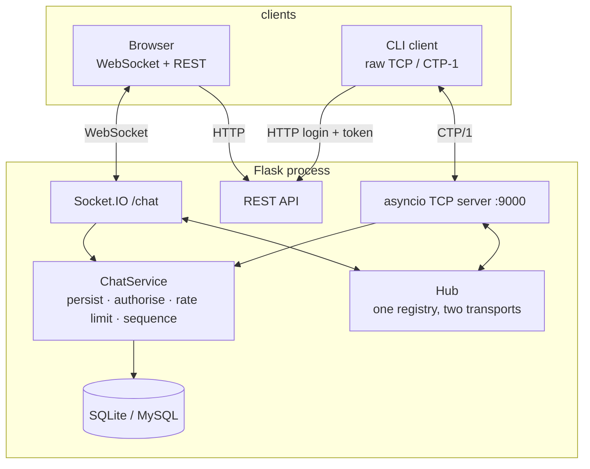

# CareerTwin

A career guidance platform with a mentor–mentee network, and a real-time
chat system that is built as a **genuine computer-network application**:
a hand-written TCP protocol with length-prefixed frames, a single-use
handshake token, heartbeats, idempotent retries and per-conversation
sequence numbers — plus a Network Inspector that shows all of it live.

> **Computer Networks course project.** The chat has two transports: a
> WebSocket (Socket.IO) one for the browser and a hand-written raw TCP one
> for the command line. They share the same service layer, so a browser and
> a terminal can chat in the same conversation.

---

## Features

### Career planning

* **Profile** — background, education, skills (as chips) and a career goal.
* **Resume analyser** — upload a PDF/DOCX/TXT, get a score, the skills that
  were detected and concrete suggestions.
* **Skill gap** — compare your skills with the benchmark for a target role.
* **Roadmap** — a milestone-by-milestone path, linked to the progress
  tracker.
* **Project recommendations** — curated ideas with a suggested tech stack,
  filterable by level.
* **Career quiz** — 20 weighted questions that rank you against four
  career paths.
* **Progress tracking** — milestones grouped by goal, with a completion ring.

### Mentorship

There is **one account system with two roles**, and two entry points:

| | Entry point | Lands on |
|---|---|---|
| **Student** | `/register` → "A student", or `/login` | the dashboard |
| **Mentor** | `/register` → "A mentor", or `/mentor/login` | the request inbox |

A mentor is simply an account that also has a published mentor profile — the
role is **derived**, never stored on the `users` table, so the roles are not
exclusive (a mentor can also ask a mentor for help) and no existing table
changes.

* Become a mentor with an expertise profile, or browse the directory.
* **Explainable matching** — a weighted overlap of your skills, your target
  role and the mentor's expertise, with the reasons shown.
* Request → accept / decline / cancel / end, with the capacity rules
  enforced on the server.
* A conversation is created when a request is accepted — and **both** sides
  can then chat live, in their own browser or with the CLI client.

### Chat and networking

* Real-time chat over **WebSocket** with typing indicators, presence,
  delivery and read receipts, an offline queue and reconnect-and-resume.
* A **hand-written TCP server** speaking CTP/1: a custom binary frame
  format, its own handshake, heartbeats and backpressure.
* A **command line client** written with nothing but the standard library's
  `socket` module.
* A **Network Inspector** (`/network`) with live RTT, a sparkline, a frame
  level event log with CSV export, and a client-side latency / packet-loss
  simulator.
* A **load test** that reports throughput and p50/p95/p99 latency.

---

## Architecture



Both transports call the same `ChatService`, so validation, authorisation,
rate limiting, sequencing and idempotency cannot drift apart. The `Hub`
delivers each message to every sink of the recipient, which is what lets a
terminal and a browser share a conversation.

See [docs/NETWORK_ARCHITECTURE.md](docs/NETWORK_ARCHITECTURE.md) for the
full layer map and the sequence diagrams.

---

## Tech stack

| Layer | Choice |
|-------|--------|
| Web framework | Flask 3 |
| ORM | Flask-SQLAlchemy 3 |
| Auth | Flask-Login (session cookie) + `itsdangerous` handshake tokens |
| CSRF | Flask-WTF |
| Templates | Jinja2 |
| Styling | hand-written CSS with a single design-token file |
| Real time | Flask-SocketIO (browser) + a hand-written asyncio TCP server |
| Database | SQLite by default, MySQL supported |

No Node build step, no front-end framework. The only third-party
front-end library is the Socket.IO client, vendored in
`frontend/static/vendor/` so the app works on an offline LAN.

---

## Getting started

```bash
cd frontend

python -m venv .venv
. .venv/Scripts/activate            # Windows
# source .venv/bin/activate         # macOS / Linux

pip install -r requirements.txt

cp .env.example .env                # then edit it
```

At a minimum `.env` needs a secret key:

```bash
python -c "import secrets; print(secrets.token_hex(32))"
```

```ini
SECRET_KEY=<the value you just printed>
FLASK_DEBUG=true
DATABASE_URL=sqlite:///careertwin.db
```

### Run it

```bash
python run.py
```

* Web app: <http://127.0.0.1:5000>
* Raw TCP chat server: `127.0.0.1:9000`

### Seed demo mentors

```bash
SEED_MENTOR_PASSWORD=choose-a-password python scripts/seed_mentors.py
```

Eight fake mentors (`mentor1@example.test` … `mentor8@example.test`). The
password comes from the environment variable and is never printed.

### Try the command line client

```bash
python -m network.cli_client --host 127.0.0.1 --port 9000 \
    --base-url http://127.0.0.1:5000 --email you@example.com
```

```
/list                 list your conversations
/open <id>            open a conversation and show its history
/whoami               show the authenticated user
/quit                 disconnect and exit
```

Anything else is sent as a message to the open conversation.

### Run the tests

```bash
python -m pytest
```

124 tests covering the frame codec, authentication and CSRF, the student /
mentor split, the mentorship rules, the chat service, token single-use and
expiry, and cross-transport delivery between a raw TCP client and a
Socket.IO client.

### Walk the whole journey

```bash
python run.py                 # in one terminal
python tools/journey.py       # in another
```

It signs a student up, signs a mentor up, publishes the mentor profile,
sends and accepts a request, and checks that both sides end up in the same
conversation.

### Smoke-test the whole surface

```bash
python tools/smoke.py
```

107 checks over every page, every endpoint and the error paths.

### Run the load test

```bash
python -m tools.loadtest --clients 8 --messages 10 \
    --host 127.0.0.1 --port 9000 --base-url http://127.0.0.1:5000
```

---

## Configuration

Every setting is read from the environment; see
[`frontend/.env.example`](frontend/.env.example) for the full list.

| Variable | Default | Purpose |
|----------|---------|---------|
| `SECRET_KEY` | — | **Required** outside debug mode. Signs the session cookie and the handshake tokens. |
| `FLASK_DEBUG` | `false` | Development mode. |
| `DATABASE_URL` | — | A full SQLAlchemy URL. Wins over everything else. |
| `MYSQL_USER` / `MYSQL_PASSWORD` / `MYSQL_HOST` / `MYSQL_PORT` / `MYSQL_DB` | — | Build a MySQL URL when `DATABASE_URL` is not set. |
| `UPLOAD_FOLDER` | `./uploads` (`/tmp/uploads` on Vercel) | Where uploaded resumes go. |
| `SESSION_COOKIE_SECURE` | `auto` | `auto` marks the cookie Secure only on HTTPS, so the LAN demo works over plain HTTP. |
| `TRUST_PROXY` | `false` | Trust `X-Forwarded-*` headers when behind a reverse proxy. |
| `TCP_CHAT_ENABLED` | `true` | Start the raw TCP server. |
| `TCP_CHAT_HOST` / `TCP_CHAT_PORT` | `127.0.0.1` / `9000` | Where the TCP server listens. |
| `TCP_CHAT_MAX_CONNECTIONS` | `100` | Connection limit. |
| `TCP_CHAT_MAX_PAYLOAD` | `16384` | Maximum frame payload (16 KiB). |
| `TCP_CHAT_HEARTBEAT` | `5` | Heartbeat interval advertised to clients. |
| `TCP_CHAT_IDLE_TIMEOUT` | `30` | Drop a connection that sends no frame for this long. |
| `TCP_CHAT_HELLO_TIMEOUT` | `5` | Drop a connection that does not authenticate in time. |
| `TCP_CHAT_WRITE_QUEUE_LIMIT` | `64` | Bounded write queue; a full queue closes a slow consumer. |
| `CHAT_TOKEN_TTL` | `60` | Lifetime of a handshake token, in seconds. |
| `CHAT_RATE_LIMIT_MESSAGES` / `CHAT_RATE_LIMIT_WINDOW` | `20` / `10` | Rate limit per user. |
| `SOCKETIO_ASYNC_MODE` | `threading` | `threading` (dev), `gevent` (production). |
| `SOCKETIO_CORS_ALLOWED_ORIGINS` | — | Comma-separated allowed origins. Never `*` in production. |
| `SEED_MENTOR_PASSWORD` | — | Password given to the seeded demo mentors. |

---

## Deployment

> **Vercel cannot run the chat.** Serverless functions cannot hold a
> WebSocket connection open and cannot listen on a raw TCP port. `vercel.json`
> is left untouched, so the rest of the app still deploys to Vercel, but the
> chat needs a process that stays alive.
>
> Deploy the chat-enabled version to **Render**, **Railway**, **Fly.io** or a
> VPS. Set `TCP_CHAT_ENABLED=0` to deploy without the chat.

### Docker

```bash
docker compose up --build
```

The compose file lives at the repository root and builds the image from
`frontend/Dockerfile`. The web app is on <http://localhost:5000> and the
raw TCP chat server on port 9000. MySQL is included in the compose file.

### Render / Railway

Point the service root at `frontend/`. The `Procfile` there runs gunicorn
with the `gevent` worker class, which is what handles thousands of
concurrent WebSocket connections on one core:

```
web: gunicorn --worker-class gevent --workers 1 --bind 0.0.0.0:$PORT app:app
```

**Use one worker.** The connection hub lives in the process that owns the
sockets — see [docs/NETWORK_ARCHITECTURE.md § 4.9](docs/NETWORK_ARCHITECTURE.md).

---

## Documentation

| Document | What is in it |
|----------|---------------|
| [docs/AUDIT.md](docs/AUDIT.md) | The state of the code before the rewrite, and every decision that followed from it. |
| [docs/PROTOCOL.md](docs/PROTOCOL.md) | The CTP/1 wire format, the state machine, the message types, the error codes and worked hex dumps. |
| [docs/NETWORK_ARCHITECTURE.md](docs/NETWORK_ARCHITECTURE.md) | The layer map, the sequence diagrams and the reasoning behind each design decision. |
| [docs/WIRESHARK.md](docs/WIRESHARK.md) | Capture filters and what each capture proves. |
| [docs/DEMO.md](docs/DEMO.md) | The one-machine and two-laptop demos, and a five-minute viva script. |

---

## Project layout

```
Career-Twin-main/
├── README.md
├── Dockerfile                  the image (the context is frontend/)
├── docker-compose.yml         app + MySQL, ports 5000 and 9000
├── docs/                      AUDIT, PROTOCOL, NETWORK_ARCHITECTURE, WIRESHARK, DEMO
└── frontend/
    ├── app.py                   app factory, page routes
    ├── config.py                environment-driven configuration
    ├── extensions.py            db, login_manager, csrf, socketio
    ├── auth.py                  register / login / logout
    ├── careers.py               single source of truth for the 4 careers
    ├── models.py                the original tables (unchanged)
    ├── mentorship_models.py     the new tables
    ├── mentorship_routes.py     the mentor directory and the request workflow
    ├── chat_routes.py           conversations, tokens, network stats
    ├── chat_service.py          persist, authorise, rate limit, sequence
    ├── chat_tokens.py           single-use handshake tokens
    ├── hub.py                   one registry, two transports
    ├── socket_events.py         the /chat namespace
    ├── run.py                   entrypoint
    ├── Procfile                 gunicorn + gevent for Render / Railway
    ├── Dockerfile               the production image
    ├── network/
    │   ├── protocol.py          the frame codec
    │   ├── tcp_server.py        the raw TCP server
    │   ├── cli_client.py        the command line client
    │   └── udp_discovery.py     optional LAN discovery
    ├── scripts/seed_mentors.py
    ├── scripts/gen_cert.sh
    ├── tools/loadtest.py
    ├── tools/smoke.py
    ├── tools/journey.py
    ├── static/
    │   ├── css/tokens.css       the only place variables are defined
    │   ├── css/base.css layout.css components.css
    │   ├── css/pages/*.css
    │   ├── js/app.js chat.js network.js resume.js
    │   ├── icons/sprite.svg
    │   └── vendor/socket.io.min.js
    ├── templates/
    │   ├── base_public.html base_app.html
    │   ├── partials/ macros/
    │   └── … one template per page
    └── tests/                   pytest
```

---

## License

Course project. The bundled Socket.IO client and the Lucide-derived icon
sprite are MIT licensed.
