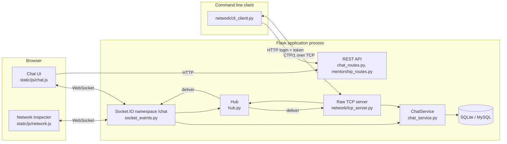
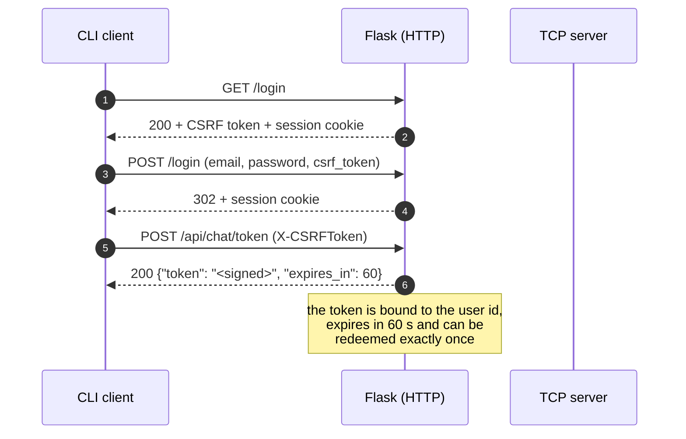
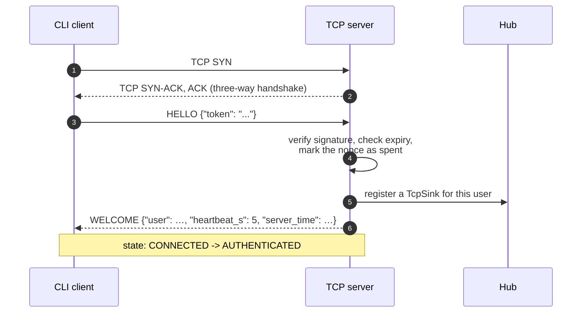
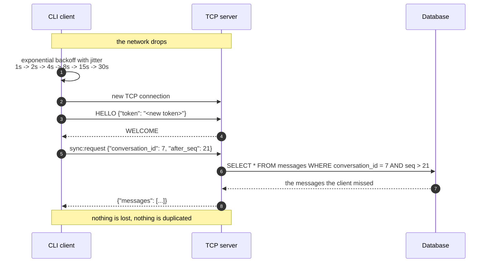
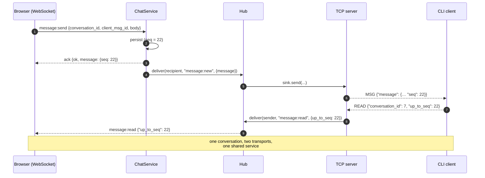

# Network architecture

How CareerTwin maps onto the TCP/IP model and the OSI model, and why each
design decision was made.

---

## 1. The layer map

```
+----------------------------------------------------------------------+
|  L7  APPLICATION     HTTP / REST (/api/*)                            |
|                       Socket.IO (WebSocket)      CTP/1 (raw TCP)     |
|                       JSON request/response     JSON frames          |
+----------------------------------------------------------------------+
|  L6  PRESENTATION    JSON encoding, UTF-8, CTP/1 frame header         |
|                       (TLS would sit here – see the stretch goals)   |
+----------------------------------------------------------------------+
|  L5  SESSION         Flask-Login session cookie, the single-use      |
|                       chat handshake token, per-conversation seq      |
+----------------------------------------------------------------------+
|  L4  TRANSPORT       TCP (both transports), reliable ordered byte    |
|                       stream, keepalive, Nagle disabled              |
+----------------------------------------------------------------------+
|  L3  NETWORK         IPv4/IPv6 addressing and routing, UDP 9001     |
|                       for the optional discovery beacon              |
+----------------------------------------------------------------------+
|  L2  DATA LINK       Ethernet / Wi-Fi, MAC addressing, ARP            |
+----------------------------------------------------------------------+
|  L1  PHYSICAL        Cat5e, Wi-Fi 802.11, TCP/IP over a LAN          |
+----------------------------------------------------------------------+
```

### Where each CareerTwin concept lives

| Concept | Layer | Implementation |
|---------|-------|----------------|
| The REST API (`/api/conversations`, `/api/mentors`, …) | L7 | Flask blueprints |
| The chat events (`message:send`, `sync:request`, …) | L7 | `socket_events.py` |
| The CTP/1 frame types (`HELLO`, `SEND`, `ACK`, …) | L7 | `network/protocol.py` |
| The 7 byte frame header (magic, version, length) | L6 | `struct.pack(">2sBI", …)` |
| UTF-8 JSON encoding of every payload | L6 | `json.dumps` / `json.loads` |
| The session cookie and the handshake token | L5 | Flask-Login, `chat_tokens.py` |
| The per-conversation `seq` | L5 | `Conversation.next_seq` |
| TCP, keepalive, `TCP_NODELAY` | L4 | `asyncio.start_server`, `setsockopt` |
| The frame counter, the write queue, the idle timer | L4 | `network/tcp_server.py` |
| IP addressing, the discovery broadcast | L3 | `socket`, `network/udp_discovery.py` |

---

## 2. The system in one picture



The important property of this diagram is the box in the middle: **both
transports call the same `ChatService` and the same `Hub`.** A message sent
from the browser is delivered by the hub to the CLI client's socket, and the
other way round, without either side knowing which transport the other is
using.

---

## 3. Sequence diagrams

### 3.1 Login and token exchange



### 3.2 The TCP handshake



### 3.3 Sending a message and its acknowledgement

```mermaid
sequenceDiagram
    autonumber
    participant C as CLI client
    participant T as TCP server
    participant S as ChatService
    participant D as Database
    participant H as Hub
    participant B as Browser (WebSocket)

    C->>T: SEND {"conversation_id": 7, "client_msg_id": "uuid", "body": "Hello!"}
    T->>S: send(user_id, conversation_id, client_msg_id, body)
    S->>S: validate, authorise, rate limit
    S->>D: BEGIN; UPDATE conversations SET next_seq = next_seq + 1; INSERT messages; COMMIT
    D-->>S: seq = 21
    S-->>T: (message, created = true)
    T-->>C: ACK {"ref": …, "seq": 21, "created": true}
    T->>H: deliver(recipient, "message:new", {message})
    H-->>B: message:new {"message": {… "seq": 21}}
    Note over T,B: persist first, broadcast second
```

If the client retries the **same** `client_msg_id` (because the ACK was
lost), the server recognises it, returns the original message and does
**not** insert a second row. The second `ACK` carries `"created": false`.

### 3.4 Reconnect and resume



### 3.5 The browser ↔ command line cross-transport path



---

## 4. Design decisions and their reasons

### 4.1 Why TCP, and not UDP?

The chat is a conversation: every message matters, and messages must arrive
**in order**. TCP gives exactly that — a reliable, ordered byte stream — and
it costs nothing extra in complexity for this use case. The one thing TCP
does *not* give us is message boundaries, which is precisely why CTP/1
carries a length prefix.

UDP would give us message boundaries for free and lower latency, at the
price of having to build reliability ourselves (retransmission, ordering,
duplicate suppression) — which is exactly the problem a chat has to solve
anyway. For a course project that has to *demonstrate* the reliability
machinery, doing it in the application layer over TCP is the honest choice:
the mechanisms (heartbeats, idempotency, sequence numbers, backoff) are
visible in the code instead of hidden in the kernel.

The optional discovery beacon (`network/udp_discovery.py`) does use UDP,
because losing a discovery packet is harmless — the next beacon arrives
three seconds later.

### 4.2 Why length-prefix framing?

See [PROTOCOL.md §1](PROTOCOL.md#1-frame-format). The short version: TCP is
a stream, so the receiver needs to be told where a message ends. A length
prefix is the simplest way to say that, and it is exactly what HTTP, TLS
and WebSocket do as well.

### 4.3 Why heartbeats?

A TCP connection can be silently dead: the peer might have lost power, or a
NAT/firewall might have dropped the mapping without sending a FIN. Without a
heartbeat the client would sit there believing it is connected, and a
message it "sent" would never be delivered.

The heartbeat solves this in two layers:

* **Application level** — the client sends `PING` every 10 seconds; if no
  frame of any kind arrives for 30 seconds the server closes the connection
  with `ERR IDLE_TIMEOUT`.
* **Transport level** — `SO_KEEPALIVE` is enabled on the socket, so the
  kernel probes a dead peer with its own keepalive packets.

The browser's WebSocket transport has the same problem, and Socket.IO solves
it the same way with its own ping/pong mechanism.

### 4.4 Why idempotency?

Networks retry. A client that times out waiting for an `ACK` cannot know
whether the server stored the message or whether the `ACK` was lost on the
way back. The only safe thing to do is send again.

Without idempotency, that retry would create a duplicate message — the
classic "exactly-once delivery" problem. The fix is the `client_msg_id`: a
UUID generated by the client, with a unique constraint on
`(conversation_id, client_msg_id)`. A repeated identifier returns the
original message, so the retry is safe. The result is *effectively-once*
delivery.

### 4.5 Why a per-conversation sequence number?

Two reasons:

1. **Ordering.** `seq` is allocated inside the same transaction that inserts
   the message, so it is gapless and strictly increasing per conversation.
   A client can therefore detect a gap and ask for the missing range.
2. **Resume.** After a reconnect the client sends `after_seq: 21` and the
   server replies with everything newer. A full reload of the history is
   never needed, which keeps the reconnect cost proportional to what was
   missed rather than to the size of the conversation.

### 4.6 Why a single-use handshake token?

The TCP port is not a web port. It has no cookies, no TLS and no CORS. If
the raw TCP protocol accepted a session cookie, the cookie would have to be
replayed on every connection — and a replayed session cookie on a plain,
unencrypted socket is a credential leak waiting to happen.

So the TCP channel authenticates with something that cannot be replayed: a
signed token that is bound to a user id, expires after 60 seconds and is
marked as spent the moment it is redeemed. The password itself never
travels over the raw socket.

### 4.7 Why one service, two transports?

`ChatService` owns everything that is not transport specific: validation,
authorisation, rate limiting, sequence allocation, persistence and
idempotency. The WebSocket handlers and the TCP handlers are thin adapters
that translate a frame into a service call and a service result back into a
frame.

The payoff is that the two transports cannot drift apart. A bug in the
authorisation rules is fixed once, and the CLI client gets the fix for
free. It is also what makes the headline demo work: a browser and a
command line client are genuinely two participants in the same
conversation.

### 4.8 Why the TCP server runs in a thread?

Flask-SocketIO's development server is either `threading` (one thread per
connection) or `eventlet`/`gevent` (a single event loop). The raw TCP
server is an `asyncio` application, and `asyncio` wants to own its thread
and its event loop.

Running it in a daemon thread with its own loop keeps the two worlds apart:
the Flask application never blocks on the TCP server, and the TCP server
never has to cooperate with the WSGI request/response cycle.

Cross-thread delivery is the interesting part. When a browser sends a
message, the Flask thread has to hand it to a socket that belongs to the
TCP server's event loop. That is what `loop.call_soon_threadsafe()` is for:
it is the documented way to interact with an asyncio loop from another
thread. The `Hub` and its `Sink` interface hide that detail behind a single
`deliver(user_id, event, payload)` call.

### 4.9 The single-process limitation

The `Hub` lives in the process that owns the sockets, and the database is
the only shared state. That means:

* A message sent over WebSocket reaches the raw TCP clients connected to
  **the same process**.
* Running two web workers (which is what `gunicorn` with more than one
  worker does) means each worker has its own hub, so a WebSocket client on
  worker 1 will not see a TCP client on worker 2.

The scale-out path is a shared pub/sub bus. Socket.IO already supports
this: point every worker at the same Redis instance and it will use the
`message_queue` option to route events between workers, and the TCP server
can publish onto the same queue. That path is deliberately **not** built
here — it would add a Redis dependency to a project whose point is to show
the protocol mechanics without hiding them behind infrastructure.

The practical consequence for the demo: run **one** process
(`python run.py`, or `gunicorn --workers 1`).

### 4.10 Why the load test uses fake users only

`tools/loadtest.py` creates accounts under `example.test` with a generated
password. It never touches a real account, and the conversations it uses are
created by the script itself. A load test that borrows real users would
leave their conversations full of noise.

---

## 5. Performance notes

Measured with `tools/loadtest.py` on a laptop, SQLite on the same disk:

```
  clients            : 8
  messages / client  : 10
  elapsed            : 1.84 s
  acknowledged       : 80
  errors             : 0
  throughput         : 43.5 msg/s
  latency p50        : 171.5 ms
  latency p95        : 183.6 ms
  latency p99        : 205.0 ms
```

The latency is dominated by the **database commit**, not by the network:
every message is committed to disk before it is acknowledged (persist first,
broadcast second), and SQLite's default `synchronous=FULL` mode fsyncs on
every commit. On a LAN with a few milliseconds of RTT the same measurement
is dominated by the same commit.

Things that would move the number, in order of effect:

1. `PRAGMA synchronous = NORMAL` on SQLite (a good trade for a chat: the
   worst case after a power cut is losing the last few messages, not
   corrupting the database).
2. Running MySQL/PostgreSQL instead of SQLite, where the commit is a network
   round trip to a server with its own write-ahead log.
3. Batching the commits — but that would break "persist before
   acknowledge", which is the property that makes the delivery guarantees
   real.
